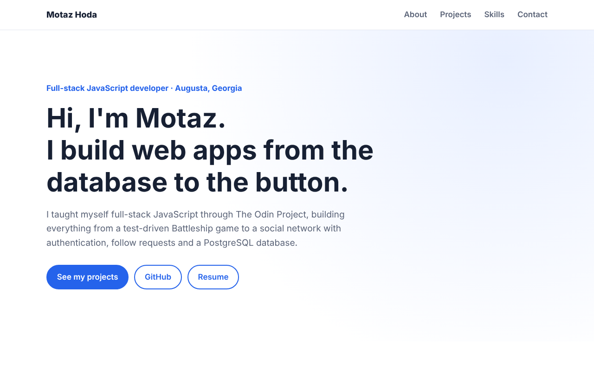

# Motaz Hoda – Developer Portfolio

My personal portfolio website, built for the **Building Your Personal Website** project in The Odin Project's [Getting Hired](https://www.theodinproject.com/paths/full-stack-javascript/courses/getting-hired) course. It's the job-hunting site I send to recruiters: who I am, my best projects, my skills and how to reach me.



## Why I built it

A resume only has room for a few lines per project. This site gives a hiring manager one link where they can see screenshots of my work, open the live demos and read the code on GitHub. Following Odin's advice, it's kept simple and fast: plain HTML, CSS and a few lines of JavaScript, no framework.

## Features

- Sections: hero, about, projects, skills, contact
- Nine Odin projects, each with a screenshot, short description, tech tags, live demo link and GitHub link
- Two featured projects (Odin-Book and Messaging App) shown larger
- Responsive down to 320px wide, with a hamburger menu on phones
- Automatic dark mode (follows the visitor's system setting)
- Accessible: skip link, alt text, real buttons/links, visible focus

## Run it locally

No build step is needed.

```bash
git clone git@github.com:motazhoda17/odin-portfolio.git
cd odin-portfolio
open index.html          # or double-click it, or use the VS Code "Live Server" extension
```

## Deploying

The easiest option is **GitHub Pages**: push to GitHub, then go to *Settings → Pages*, choose "Deploy from a branch", branch `main`, folder `/ (root)`. The site will be live at `https://motazhoda17.github.io/odin-portfolio/`. Netlify or Vercel also work (drag-and-drop the folder, no build command).

## Files

```
index.html     all the content
styles.css     all the styling (colors are CSS variables at the top)
script.js      mobile menu toggle + footer year
images/        project screenshots (odin-book.png and messaging-app.png are real screenshots;
               the .jpg files are "coming soon" placeholders)
docs/          screenshot used in this README
```

## Placeholders to fill in before publishing

Search the project for `PLACEHOLDER` to find each one.

| Where | What to fill in |
| ----- | --------------- |
| `index.html` hero | **Resume** button `href` → link to your hosted resume PDF |
| `index.html` about | Your **four languages** (highlighted in yellow on the page) |
| `index.html` about | Optional: a photo of yourself (`images/motaz.jpg`) to replace the "MH" circle |
| `index.html` projects | Each project's **Live demo** `href` (9 links) |
| `index.html` contact | **Email** address in the `mailto:` link |
| `index.html` contact | **LinkedIn** profile URL |
| `images/*.jpg` | Replace the 7 "Screenshot coming soon" images with real screenshots of each project (keep the same file names, or update the `src` in `index.html`) |

Also double-check:

- Every GitHub link points to `https://github.com/motazhoda17/<repo>`. The repo names used are `odin-book`, `odin-messaging-app`, `odin-blog-api`, `odin-wheres-waldo`, `odin-members-only`, `odin-shopping-cart`, `odin-battleship`, `odin-weather-app` and `odin-todo-list` – rename them here if your repos are named differently.
- Each project's README has a screenshot, a "why I built it" section and setup steps (Odin's documentation advice).

## What I practiced

- Writing for two audiences: non-technical recruiters and technical reviewers
- Semantic, accessible HTML and a responsive CSS Grid / Flexbox layout
- CSS custom properties for theming and `prefers-color-scheme` for dark mode
- Small, progressive-enhancement JavaScript (the page works without it)
